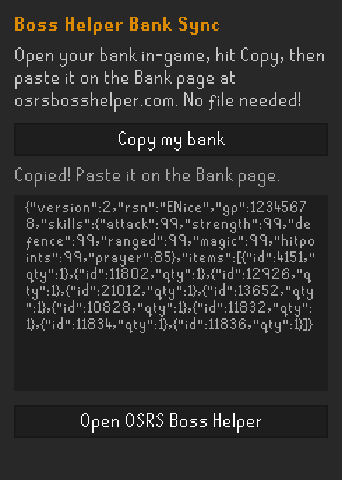
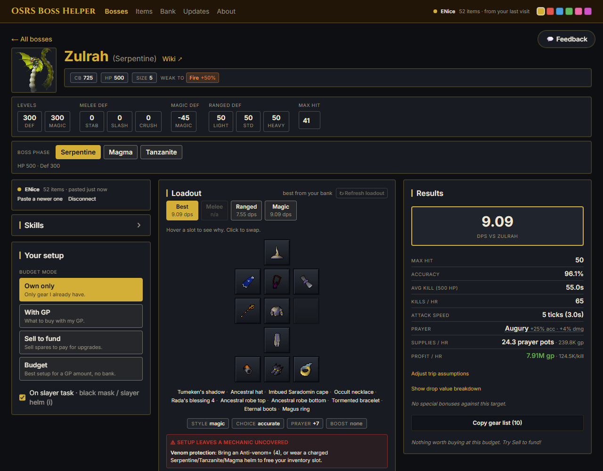

# Boss Helper Bank Sync

Brings your bank into [OSRS Boss Helper](https://osrsbosshelper.com), a free site that finds the best DPS setup for any boss using the gear you actually own.



## How to use it

1. Install the plugin from the Plugin Hub and turn it on.
2. Log in and open your bank once.
3. Click the Boss Helper icon in the sidebar and hit **Copy my bank**.
4. Go to the [Bank page](https://osrsbosshelper.com/bank) on the site, paste it in the box and hit **Load bank**.

And that's it! Pick a boss and you'll get the best setup from your bank in all three combat styles. Your combat levels come along too, so there's nothing to type in.



Open your bank again whenever you've picked up new gear, hit Copy, and paste the new one. The site keeps the last bank you pasted.

## Rather skip the copy and paste?

Turn on **Save my bank & gear for the web app** in the plugin settings. The plugin then keeps a `bank.json` file up to date while you play. On the site's Bank page, hit **Connect bank file** and pick it (Chrome, Edge or Brave). After that it refreshes on its own every time you bank. Other browsers can upload the file instead.

Where the file is:

- Windows: `C:\Users\<you>\.runelite\osrs-boss-helper\bank.json`
- Mac and Linux: `~/.runelite/osrs-boss-helper/bank.json`

## Good to know

- It only reads your bank, inventory, worn gear, skills and GP. It never clicks, moves or changes anything in the game.
- It remembers your bank between sessions, and separately for each account, so logging into an alt won't wipe your main's bank.
- What it remembers is the last bank it saw. If you bank on mobile, open your bank in RuneLite again to refresh it.
- Nothing is sent anywhere. The plugin makes no network requests. The only outputs are the file in your RuneLite folder and your clipboard.

This is a one-person hobby project, so expect some rough edges. If something looks off or you want something added, hit the Feedback button on the site or open an issue here. The [site's code](https://github.com/ENiceApps/osrs-boss-helper) is open source too.

Thank you,

— ENice

## For developers

```bash
./gradlew build      # compile and unit checks (Java 11)
./gradlew run        # dev RuneLite client with the plugin side-loaded
```

Plugin behaviour can only be checked by a person in the real client. To log in to the dev client, follow RuneLite's ["Using Jagex Accounts"](https://github.com/runelite/runelite/wiki/Using-Jagex-Accounts) guide. Don't use automation tools on the game; that breaks Jagex's third-party client rules.

This folder is the source for the Hub build, mirrored from the `plugin/` directory of the [osrs-boss-helper](https://github.com/ENiceApps/osrs-boss-helper) repo. Licensed BSD-2-Clause, see [LICENSE](LICENSE).
